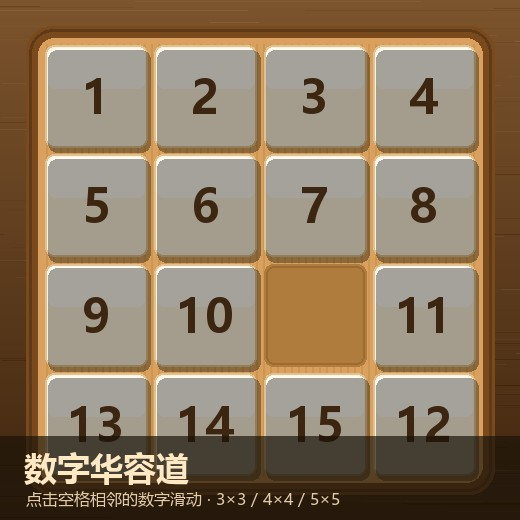

<p align="center">
  
</p>

<h1 align="center">童年游戏合集</h1>

<p align="center">
  <a href="http://www.apache.org/licenses/LICENSE-2.0"></a>
  <a href="https://github.com/AloysHF/childhood/actions/workflows/childhood.yml"></a>
  <a href="https://github.com/AloysHF/childhood/actions/workflows/codeql-analysis.yml"></a>
  <a href="https://aloyshf.github.io/childhood/"></a>
  <a href="https://childhood-cck.pages.dev/"></a>
  <a href="https://sonarcloud.io/dashboard?id=AloysHF_childhood"></a>
  <a href="https://discord.gg/E4SQjXUkZy"></a>
  <a href="https://qm.qq.com/q/LAO7DKAWUC"></a>
</p>

一个纯前端经典游戏合集，收录了 **28 款**童年桌游与卡牌游戏，开箱即玩。支持双人对战、人机对战和联网对战；人机模式可在对局中切换简单、普通、困难和大师四档 AI 难度。

**在线体验**：[GitHub Pages（主站）](https://aloyshf.github.io/childhood/) · [Cloudflare Pages（镜像）](https://childhood-cck.pages.dev/)

## 卡牌游戏


| 刀杀鸡 | 龙虎斗 | 兽棋 |
|:------:|:------:|:----:|
|  |  |  |

| 军师旅团营 | 猫捉老鼠 | 小皇帝 |
|:-------------:|:-------:|:------:|
|  |  |  |

| 布告棋（官打捉贼） |
|:------------------:|
|  |

## 经典棋盘游戏


| 中国象棋 | 国际象棋 | 军棋（棋盘版） |
|:-------:|:-------:|:------------:|
|  |  |  |

| 五子棋 | 黑白棋 | 国际跳棋 |
|:-----:|:-----:|:-------:|
|  |  |  |

| 中国跳棋 | 围棋 | 斗兽棋 | 将棋 |
|:-------:|:---:|:-----:|:----:|
|  |  |  |  |

## 欢乐骰子游戏


| 飞行棋 | 大富翁 |
|:-----:|:-----:|
|  |  |

## 童年棋盘游戏


| 井字棋 | 狼吃羊 | 憋茅坑 | 小猫钓鱼 |
|:-----:|:-----:|:-------:|:-------:|
|  |  |  |  |

| 钻牛角尖 | 摆四龙 | 蚂蚁搬家 | 四步钉 |
|:-------:|:-----:|:------:|:-----:|
|  |  |  |  |

| 数字华容道 |
|:----------:|
|  |

## 项目结构

```
childhood/
├── apps/
│   ├── card-game/                    # 童年经典卡牌游戏
│   │   ├── knife-kills-chicken/      # 刀杀鸡
│   │   ├── dragon-tiger-fight/       # 龙虎斗
│   │   ├── animal-chess/             # 兽棋
│   │   ├── chinese-army-chess/       # 军师旅团营
│   │   ├── cat-and-mouse/            # 猫捉老鼠
│   │   ├── little-emperor/           # 小皇帝
│   │   └── guan-da-zhuo-zei/         # 布告棋（官打捉贼）
│   ├── board-game/                   # 经典棋盘游戏
│   │   ├── chinese-chess/            # 中国象棋
│   │   ├── international-chess/      # 国际象棋
│   │   ├── chinese-army-chess/       # 军棋（棋盘版）
│   │   ├── gomoku/                   # 五子棋
│   │   ├── reversi/                  # 黑白棋
│   │   ├── checkers/                 # 国际跳棋
│   │   ├── chinese-checkers/         # 中国跳棋
│   │   ├── go/                       # 围棋
│   │   ├── dou-shou-qi/              # 斗兽棋
│   │   └── shogi/                    # 将棋
│   ├── dice-game/                    # 欢乐骰子游戏
│   │   ├── flying-chess/             # 飞行棋
│   │   └── monopoly/                 # 大富翁
│   ├── childhood-board-game/         # 童年棋盘游戏
│   │   ├── tic-tac-toe/              # 井字棋
│   │   ├── lang-chi-yang/            # 狼吃羊
│   │   ├── bie-mao-keng/             # 憋茅坑
│   │   ├── xiao-mao-diao-yu/         # 小猫钓鱼
│   │   ├── zuan-niu-jiao-jian/       # 钻牛角尖
│   │   ├── bai-si-long/              # 摆四龙
│   │   ├── ma-yi-ban-jia/            # 蚂蚁搬家
│   │   ├── si-bu-ding/               # 四步钉
│   │   └── number-puzzle/            # 数字华容道
│   └── common/                       # 共享模块
│       ├── card-game-core.js         # 卡牌游戏核心逻辑
│       ├── game-utils.js             # 游戏工具函数
│       ├── webrtc-connection.js      # WebRTC P2P 连接管理器
│       ├── network-game-protocol.js  # 联网游戏消息协议
│       ├── room-ui.js                # 房间创建/加入 UI 组件
│       └── room-ui.css               # 房间 UI 样式
├── js/                               # 全局 JavaScript
├── css/                              # 全局样式
├── images/                           # 图片资源
├── index.html                        # 入口页面
└── package.json                      # 项目配置
```

## 快速开始

```bash
# 克隆项目
git clone https://github.com/AloysHF/childhood.git
cd childhood

# 安装依赖
npm install
```

直接用浏览器打开`index.html`即可，或者`npx serve`后访问<http://localhost:3000>

## 运行测试

```bash
# 执行全部测试
npm test

# 监听模式
npm run test:watch
```

## 许可证

[Apache License 2.0](LICENSE)
